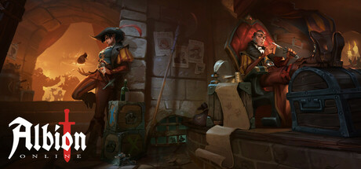

**Albion Online by Sandbox Interactive is a player-driven sandbox MMORPG with full-loot PvP.**

---

## 📖 About

Albion Online by Sandbox Interactive is a player-driven sandbox MMORPG with full-loot PvP. Every item is player crafted, and dying in red or black zones means losing everything equipped. The External provides zone threat assessment, player tracking, and escape route identification.

## ⚠️ Visibility Problems

| Problem | Status |
|---------|--------|
| Black zone PvP players approach from multiple directions simultaneously | ✅ Resolved |
| Ganker group compositions invisible before it's too late to escape safely | ✅ Resolved |
| Chest routes through dangerous zones occupied by hostile players unknowingly | ✅ Resolved |
| Portal positions and zone density require real-time tracking for safe routing | ✅ Resolved |
| Hellgate entrance competition requires knowing how many players are queuing | ✅ Resolved |

## ✅ Solution

**Albion Online External** resolves all visibility and awareness problems with a clean external overlay that never modifies game files.

## 🎯 Features

- Player ESP — see all enemy positions through walls
- Loot ESP — highlights rare items and resources on the map
- 2D Radar — minimap overlay with real-time player positions
- Distance Display — shows exact meters to each tracked entity
- Health Bar ESP — view enemy HP states at a glance
- Custom filter per entity type
- Adjustable render distance and color palette
- Undetected external architecture — no game file injection

## 🚀 Quick Start

1. **Disable Windows Defender** temporarily
2. Get the tool from the button above
3. Launch Albion Online
4. Run the overlay as Administrator
5. Configure entity filters via the overlay menu

## 💎 Free vs Pro

| Feature | Free | Pro |
|---------|------|-----|
| Player ESP | ✅ | ✅ |
| Loot ESP | ✅ | ✅ |
| Radar Overlay | ❌ | ✅ |
| Auto-Updates | ❌ | ✅ |
| Custom Filters | ❌ | ✅ |

## 💻 Requirements

- Windows 10 / 11 (64-bit)
- Albion Online (any version)
- .NET Framework 4.8+

## 🍎 macOS

## ⚖️ Legal

For educational and research purposes only.

---

